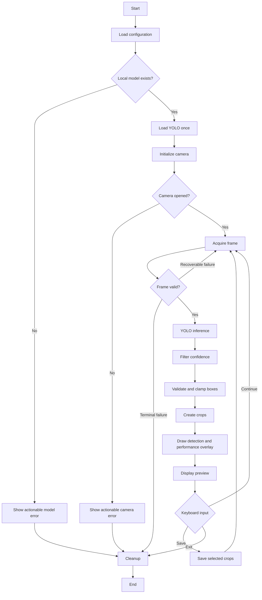

# Product Requirements Document — Smart Parking System

## 1. Document Control

| Atribut | Nilai |
|---|---|
| Judul dokumen | Product Requirements Document — Smart Parking System |
| Nama produk | Smart Parking System |
| Repository root | `005. Smart Parking System/` |
| Computer Vision capability | ANPR (Automatic Number Plate Recognition) |
| Versi | 1.0 (Initial Draft) |
| Status | Draft |
| Terakhir diperbarui | 30 Oktober 2026 |
| Document owner | To Be Assigned |
| Fase saat ini | Phase 1 — Webcam-Based License Plate Detection Using YOLO |

### Revision History

| Versi | Tanggal | Penulis | Perubahan | Status |
|---|---|---|---|---|
| 1.0 | 30 Oktober 2026 | To Be Assigned | Initial Draft berdasarkan audit repository aktual | Draft |

Tidak ada approval history yang tercatat saat dokumen ini dibuat.

## 2. Executive Summary

Smart Parking System adalah produk kontrol akses parkir sepeda motor berbasis Computer Vision dan IoT. Capability ANPR direncanakan untuk mendeteksi plat nomor, mengenali karakter, memvalidasi kendaraan, dan pada fase lanjutan mengendalikan barrier gate serta menyediakan monitoring operasional.

Produk ini ditujukan untuk mengurangi ketergantungan pada observasi manual, meningkatkan konsistensi identifikasi kendaraan, dan membangun fondasi otomasi akses parkir. Belum ada bukti repository yang menunjukkan sistem lengkap tersebut telah diimplementasikan atau diuji.

Phase 1 dibatasi pada prototipe deteksi plat nomor sepeda motor Indonesia secara real-time menggunakan webcam, OpenCV, dan model YOLO khusus plat nomor. Output fase ini adalah aplikasi Python lokal yang mampu membuka kamera, menjalankan inference, menampilkan bounding box dan confidence, membuat crop plat, menyimpan crop secara manual, menampilkan informasi performa dasar, serta menutup kamera dengan aman.

Prototipe ini menjadi dasar teknis untuk OCR, authorization, parking session, microcontroller, barrier gate, API, dashboard, dan deployment edge. Seluruh capability lanjutan tetap berstatus planned dan bukan deliverable Phase 1.

## 3. Repository Assessment dan Baseline Implementasi

Audit dilakukan terhadap repository aktual `005. Smart Parking System/` pada 30 Oktober 2026.

| Area | Bukti repository | Status aktual |
|---|---|---|
| Vision entry point | `apps/vision/src/main.py` hanya mencetak pesan placeholder | Belum diimplementasikan |
| Camera configuration | `apps/vision/configs/camera.yaml` memuat source `0`, 1920x1080, 30 FPS | Scaffold tersedia; belum dikonsumsi aplikasi |
| Detection configuration | Model path, confidence `0.35`, image size `960` tersedia di YAML | Scaffold tersedia; belum dikonsumsi aplikasi |
| YOLO model | `ml/weights/` hanya berisi `.gitkeep`; `license_plate.pt` tidak ada | Blocker |
| Dataset | Seluruh folder `data/` hanya berisi placeholder | Belum tersedia |
| Automated tests | `apps/vision/tests/` hanya berisi `.gitkeep` | Belum tersedia |
| Evaluation | `docs/computer-vision/EVALUATION.md` tidak ada | Belum tersedia |
| API | `apps/api/app/main.py` adalah placeholder | Future phase |
| Web | Struktur folder tersedia tanpa implementasi | Future phase |
| Firmware | File Arduino hanya berisi komentar placeholder | Future phase |
| Dependencies | `ultralytics`, `opencv-python`, `numpy`, `pyserial`, `python-dotenv` | Daftar tersedia; instalasi belum diverifikasi |
| Governance | Root `AGENTS.md` dan `.git/` tidak ditemukan | Pending |

### 3.1 Status Implementasi

- **Implemented:** belum ada capability fungsional Phase 1 yang dapat dikonfirmasi.
- **In Progress / Scaffolded:** struktur modular, file konfigurasi kamera/deteksi, entry point placeholder, dan folder test tersedia.
- **Planned:** workflow webcam, inference, visualization, cropping, saving, evaluation, OCR, IoT, API, database, dan frontend.

### 3.2 Blocker Phase 1

1. Model `ml/weights/license_plate.pt` tidak tersedia.
2. Tidak ada implementasi camera capture atau YOLO inference.
3. Tidak ada loader untuk `camera.yaml` atau environment variables.
4. Tidak ada dataset atau sample media untuk evaluasi.
5. Tidak ada automated test, test plan, atau evaluation protocol.
6. Spesifikasi webcam serta kemampuan CPU/GPU laptop belum diverifikasi.
7. README menggunakan nama “Smart Parking ANPR”; nama produk resmi adalah Smart Parking System, sedangkan ANPR adalah capability Computer Vision.
8. `pyserial` sudah tercantum walaupun Arduino di luar Phase 1; PRD ini tidak mengubah dependency.

## 4. Problem Statement

Kontrol akses parkir manual bergantung pada kemampuan operator mengamati kendaraan dan plat nomor secara cepat serta konsisten. Pencahayaan, sudut kendaraan, motion blur, ukuran plat kecil, antrean, dan variasi format plat dapat menyebabkan observasi tidak konsisten dan pencatatan sulit ditelusuri.

Deteksi plat otomatis menyediakan input visual yang konsisten bagi OCR dan authorization pada fase lanjutan. Namun, kelayakan teknis harus dibuktikan pada kondisi sepeda motor Indonesia, termasuk plat hitam dan putih, menggunakan perangkat aktual. Belum tersedia data terukur mengenai akurasi, latency, atau dampak bisnis; dokumen ini tidak mengasumsikan hasil tersebut.

## 5. Product Vision and Objectives

### 5.1 Long-Term Product Vision

Membangun sistem kontrol akses parkir sepeda motor yang modular dan scalable dengan alur:

`Camera → YOLO Plate Detection → OCR → Plate Validation → Vehicle Authorization → Parking Management → Microcontroller → Automated Barrier Gate`

Sistem jangka panjang mendukung monitoring web, centralized storage, migrasi webcam ke RTSP IP Camera, dan deployment laptop ke mini PC atau edge device.

### 5.2 Phase 1 Technical Objectives

1. Membuktikan webcam dapat dibuka dan frame diproses kontinu.
2. Memuat satu instance model YOLO khusus plat nomor.
3. Mendeteksi dan memvisualisasikan plat pada live video.
4. Menghasilkan crop valid dan menyimpannya secara manual.
5. Mengukur latency dan effective FPS pada hardware aktual.
6. Mengidentifikasi failure cases plat motor Indonesia.
7. Menjaga camera interface agar dapat diganti ke RTSP tanpa menulis ulang detector.
8. Menyediakan error handling dan resource cleanup yang dapat diverifikasi.

### 5.3 Future Business Objectives

- Mengotomatisasi identifikasi kendaraan masuk/keluar.
- Mendukung authorization berdasarkan data kendaraan yang disetujui.
- Mendukung parking session dan audit event.
- Mengurangi interaksi manual pada barrier gate.
- Menyediakan monitoring operasional terpusat.

Tujuan bisnis tersebut planned dan belum divalidasi melalui stakeholder interview atau data operasional.

## 6. Product Stakeholders and Users

Belum ada stakeholder resmi tercatat. Peran berikut adalah **proposed roles**.

| Peran | Kebutuhan utama | Status |
|---|---|---|
| System Administrator | Konfigurasi sistem, perangkat, model, dan akses | Proposed, future phase |
| Parking Operator | Memantau detection dan menangani pengecualian | Proposed |
| Computer Vision Developer | Mengembangkan dan mengevaluasi model/pipeline | Proposed, pengguna utama Phase 1 |
| System Maintainer | Diagnosis perangkat, log, dan lifecycle | Proposed |
| Vehicle User | Mengakses parkir dengan kendaraan terdaftar | Proposed, future phase |
| Product Owner | Menetapkan acceptance threshold dan prioritas | To Be Assigned |

## 7. User Stories

### 7.1 Phase 1

- **US-001 — As a Computer Vision Developer, I want to initialize a configured webcam, so that I can acquire live frames for ANPR experiments.**
- **US-002 — As a Computer Vision Developer, I want a clear camera error when the source is unavailable, so that I can troubleshoot without an application hang.**
- **US-003 — As a Computer Vision Developer, I want to load a license-plate-specific YOLO model once, so that inference is efficient and reproducible.**
- **US-004 — As a Parking Operator, I want detected plates marked with bounding boxes, so that I can verify what the system sees.**
- **US-005 — As a Parking Operator, I want confidence values visible, so that uncertain detections can be identified.**
- **US-006 — As a Computer Vision Developer, I want configurable confidence and image size, so that I can evaluate speed–quality trade-offs.**
- **US-007 — As a Computer Vision Developer, I want valid plate crops, so that samples are available for evaluation and future OCR.**
- **US-008 — As a Computer Vision Developer, I want to save selected crops with a keyboard command, so that only useful samples are retained.**
- **US-009 — As a Computer Vision Developer, I want live FPS and latency, so that I can characterize laptop performance.**
- **US-010 — As a System Maintainer, I want camera and windows released on every exit path, so that the device is not left locked.**
- **US-011 — As a Computer Vision Developer, I want invalid bounding boxes rejected safely, so that crop operations cannot crash the loop.**
- **US-012 — As a Computer Vision Developer, I want documented failure cases, so that improvements are evidence-driven.**

### 7.2 Planned Future Stories

- **US-F01 — As a Parking Operator, I want plate characters recognized by OCR, so that detected vehicles can be identified.** *(Phase 2)*
- **US-F02 — As a System Administrator, I want recognized plates checked against authorization data, so that access follows policy.** *(Phase 3)*
- **US-F03 — As a Parking Operator, I want authorized decisions to operate a barrier gate, so that access can be automated.** *(Phase 4–5)*
- **US-F04 — As a Parking Operator, I want a monitoring dashboard, so that events and system health can be reviewed.** *(Phase 6–7)*

## 8. Functional Requirements

| ID | Requirement Name | Description | Priority | Phase | Acceptance Criteria | Implementation Status |
|---|---|---|---|---|---|---|
| FR-001 | Configuration Loading | Membaca camera source, resolution, FPS, model path, confidence, dan image size dari konfigurasi terpusat. | Must Have | Phase 1 | AC-001 | Scaffold only |
| FR-002 | Webcam Initialization | Membuka built-in atau USB webcam berdasarkan camera source. | Must Have | Phase 1 | AC-002 | Belum diimplementasikan |
| FR-003 | Camera Property Request | Meminta width, height, FPS dan melaporkan nilai aktual driver. | Should Have | Phase 1 | AC-002, AC-003 | Belum diimplementasikan |
| FR-004 | Frame Acquisition | Membaca frame kontinu dan menolak frame kosong/tidak valid. | Must Have | Phase 1 | AC-003, AC-010 | Belum diimplementasikan |
| FR-005 | Local Model Validation | Memverifikasi file model sebelum membuat YOLO instance; tidak melakukan silent download. | Must Have | Phase 1 | AC-004, AC-010 | Model tidak tersedia |
| FR-006 | Single Model Lifecycle | Memuat model satu kali dan menggunakannya ulang sepanjang loop. | Must Have | Phase 1 | AC-004, AC-011 | Belum diimplementasikan |
| FR-007 | Plate-Specific Inference | Memproses frame valid dengan YOLO khusus license plate. | Must Have | Phase 1 | AC-005 | Belum diimplementasikan |
| FR-008 | Confidence Filtering | Tidak meneruskan detection di bawah threshold ke visualization/crop. | Must Have | Phase 1 | AC-005, AC-006 | Konfigurasi saja |
| FR-009 | Configurable Image Size | Inference image size dapat diubah tanpa edit source code. | Should Have | Phase 1 | AC-001, AC-012 | Konfigurasi saja |
| FR-010 | Bounding Box Validation | Mengubah coordinate ke integer, clamp ke frame, dan menolak zero-area box. | Must Have | Phase 1 | AC-006, AC-007 | Belum diimplementasikan |
| FR-011 | Box Visualization | Menggambar bounding box dan class label untuk detection valid. | Must Have | Phase 1 | AC-005 | Belum diimplementasikan |
| FR-012 | Confidence Visualization | Menampilkan confidence dengan presisi konsisten. | Must Have | Phase 1 | AC-006 | Belum diimplementasikan |
| FR-013 | Live Preview | Menampilkan annotated video dan tetap merespons keyboard. | Must Have | Phase 1 | AC-003, AC-009 | Belum diimplementasikan |
| FR-014 | Plate Cropping | Membuat crop dari frame asli menggunakan box tervalidasi. | Must Have | Phase 1 | AC-007 | Belum diimplementasikan |
| FR-015 | Manual Crop Saving | Menyimpan crop melalui hotkey dengan directory aman dan filename unik. | Must Have | Phase 1 | AC-008 | Belum diimplementasikan |
| FR-016 | Performance Overlay | Mengukur dan menampilkan inference latency dan effective FPS. | Should Have | Phase 1 | AC-009, AC-012 | Belum diimplementasikan |
| FR-017 | Graceful Cleanup | Semua normal/error exit melepaskan camera dan OpenCV windows. | Must Have | Phase 1 | AC-010, AC-011 | Belum diimplementasikan |
| FR-018 | Camera Source Abstraction | Pipeline menerima frame dari abstraction agar RTSP dapat ditambahkan tanpa mengubah detector. | Should Have | Phase 1 foundation | AC-001, AC-011 | Struktur saja |
| FR-019 | Capture Metadata | Crop menyimpan metadata minimal untuk timestamp/configuration traceability. | Could Have | Phase 1 | AC-008, AC-012 | Belum diimplementasikan |
| FR-020 | OCR and Access Control | OCR, authorization, parking session, API, database, dan barrier control. | Won't Have for Current Phase | Phase 2–7 | Tidak berlaku | Belum diimplementasikan |

## 9. Non-Functional Requirements

Target angka yang belum diuji ditandai **Provisional Engineering Target**.

| ID | Kategori | Requirement | Target / Verification | Status |
|---|---|---|---|---|
| NFR-001 | Performance | Live loop tetap responsif saat inference. | **Provisional:** effective FPS ≥ 10 pada pilot, atau baseline dan bottleneck didokumentasikan. | Belum diverifikasi |
| NFR-002 | Performance | Inference dan end-to-end latency diukur terpisah. | **Provisional:** median dan p95 dari ≥300 frame valid. | Belum diverifikasi |
| NFR-003 | Reliability | Satu frame gagal tidak menghasilkan crop invalid atau silent crash. | Failure injection test. | Belum diimplementasikan |
| NFR-004 | Resource | Satu model instance dan satu active camera handle per process. | Lifecycle test/instrumentation. | Belum diimplementasikan |
| NFR-005 | Resource | Camera/windows selalu dilepas pada normal exit dan exception. | Cleanup test. | Belum diimplementasikan |
| NFR-006 | Maintainability | Camera, detector, visualization, saving, config, dan pipeline terpisah. | Code review dan module tests. | Struktur tersedia |
| NFR-007 | Usability | Hotkey ditampilkan/didokumentasikan dan exit tanpa force-kill. | Manual usability check. | Belum diimplementasikan |
| NFR-008 | Portability | Mendukung Windows laptop dan tidak terikat webcam index saja. | Webcam test; RTSP future test. | Belum diverifikasi |
| NFR-009 | Security | RTSP credential/secret tidak ada di source atau log. | Static/config review. | RTSP belum ada |
| NFR-010 | Privacy | Crop disimpan explicit ke lokasi terkonfigurasi dan tidak di-commit. | Workflow dan `.gitignore` review. | Sebagian scaffold |
| NFR-011 | Extensibility | Detector output netral agar OCR tidak bergantung pada object Ultralytics. | Interface review. | Belum diimplementasikan |
| NFR-012 | Logging | Startup, effective config, model/camera error, shutdown tercatat tanpa data sensitif. | Log review. | Belum diimplementasikan |
| NFR-013 | Offline | Setelah dependency/model lokal tersedia, inference tidak butuh network. | Offline test. | Belum diverifikasi |
| NFR-014 | Reproducibility | Evaluation mencatat model, threshold, image size, camera, dan software version. | Artifact review. | Belum diimplementasikan |
| NFR-015 | Data Integrity | Crop identik dengan area box pada frame sebelum annotation overlay. | Pixel/coordinate test. | Belum diimplementasikan |

## 10. Phase 1 System Workflow

1. Resolve project paths dan load configuration.
2. Verifikasi file model lokal dan load satu YOLO instance.
3. Initialize camera dan baca properties aktual.
4. Acquire serta validasi frame.
5. Jalankan inference dan confidence filtering.
6. Validasi/clamp bounding box dan buat crop dari frame asli.
7. Gambar box, confidence, FPS, dan latency.
8. Tampilkan live preview.
9. Tangani hotkey save atau exit.
10. Ulangi sampai exit/error dan selalu cleanup resources.

## 11. Computer Vision Requirements

### 11.1 Model

- Model harus khusus license plate detection; generic COCO YOLO tidak boleh diasumsikan mendeteksi plat.
- Expected configurable path: `ml/weights/license_plate.pt`; file belum tersedia.
- Missing/invalid model menghasilkan actionable error, bukan silent download atau klaim palsu.
- Existing detector dievaluasi sebelum memutuskan training dari awal.
- Fine-tuning data motor Indonesia dilakukan hanya bila evaluation membuktikan gap.

### 11.2 Operating Conditions

- Mencakup plat hitam lama dan plat putih baru.
- Mencakup small plate, variasi font/spacing, holder, kotoran, glare, dan occlusion.
- Menguji jarak, yaw/pitch, tinggi kamera, posisi kendaraan, daylight, indoor, backlight, low light, dan motion blur.
- Resolution aktual dicatat; request 1920x1080 tidak menjamin driver memberikannya.
- Image size configurable karena resizing dapat menghilangkan detail small object.

### 11.3 Detection Output

- Confidence `0.35` dan image size `960` adalah baseline configuration, bukan nilai tervalidasi.
- Box wajib memenuhi `x2 > x1` dan `y2 > y1` setelah clamp.
- Mapping ke frame asli harus akurat saat YOLO melakukan resize/letterbox.
- Crop dibuat sebelum overlay agar garis/teks tidak masuk sample.
- Multiple detection diproses independen.
- Detection stability antar-frame diukur; tracking bukan scope wajib Phase 1.

## 12. Dataset Requirements

Tidak ada dataset aktual pada repository saat audit.

| Area | Requirement |
|---|---|
| Scope | Motor Indonesia dengan plat hitam/putih pada kondisi representatif pilot |
| Diversity | Lokasi, lighting, cuaca, jarak, sudut, blur, occlusion, tipe motor, background |
| Negative samples | Frame tanpa plat, objek mirip plat, kendaraan lain, signage, text region |
| Annotation | YOLO detection format dengan class canonical `license_plate`, kecuali taxonomy lain disetujui |
| Box quality | Tight box mencakup seluruh plat tanpa background berlebihan |
| Versioning | Version ID, changelog, provenance, dan annotation guideline version |
| Split | Train/validation/test dipisahkan sebelum tuning; proporsi setelah volume diketahui |
| Leakage | Frame dari video/vehicle/session sama tidak tersebar lintas split |
| Test integrity | Test set dikunci dan tidak dipakai threshold tuning/model selection |
| Licensing | Hak penggunaan/distribusi setiap source diverifikasi |
| Privacy | Plat diperlakukan sebagai data sensitif; akses, retention, sharing dibatasi |
| Storage | Binary data tidak di-commit; gunakan folder data yang tersedia |

## 13. Phase 1 Acceptance Criteria

Seluruh criteria masih **belum diverifikasi**.

| ID | Acceptance Criterion | Metode Verifikasi |
|---|---|---|
| AC-001 | Konfigurasi project-relative dibaca dan effective config dilaporkan tanpa absolute path hardcoded. | Configuration test/log review |
| AC-002 | Webcam valid dapat dibuka; source invalid memberi error jelas dan non-zero exit. | Hardware/negative test |
| AC-003 | Live window menampilkan frame kontinu dan merespons keyboard. | Manual demonstration |
| AC-004 | Model valid dimuat satu kali; model hilang/invalid menghasilkan actionable error tanpa silent download. | Lifecycle test |
| AC-005 | Pada sample detectable, bounding box dan class label tampil pada posisi benar. | Visual/annotation comparison |
| AC-006 | Confidence sesuai detector dan detection di bawah threshold tidak divisualisasikan. | Deterministic output test |
| AC-007 | Crop valid, tidak kosong, berada dalam frame, dan sesuai source box. | Unit/pixel test |
| AC-008 | Hotkey save menghasilkan filename unik; tanpa hotkey tidak ada capture tersimpan. | Filesystem integration test |
| AC-009 | Preview menampilkan inference latency dan effective FPS tanpa mengubah detection. | Runtime observation |
| AC-010 | Frame invalid, read failure, dan empty detection tidak menyebabkan invalid crop/silent crash. | Failure injection |
| AC-011 | Semua exit path melepas camera/windows dan camera dapat dibuka kembali. | Cleanup/reopen test |
| AC-012 | Evaluation mencatat model/config/hardware, quality metrics, latency, FPS, dan failure cases tanpa hasil fiktif. | Report review |
| AC-013 | Demo mencakup plat motor hitam dan putih atau limitation eksplisit bila sample belum tersedia. | Demonstration record |

### 13.1 Provisional Completion Targets

- **Provisional Engineering Target:** ≥300 frame valid untuk baseline performance run.
- **Provisional Engineering Target:** ≥50 annotated plate instances per warna plat untuk smoke evaluation bila data legal tersedia.
- **Provisional Engineering Target:** tidak ada critical crash selama sesi demo kontinu 30 menit.
- Minimum Precision/Recall/mAP belum ditetapkan sampai pilot condition dan risk tolerance disepakati.

## 14. Success Metrics and KPIs

Belum ada measured result. Metrics berikut proposed.

### 14.1 Model Quality Metrics

| Metric | Penggunaan |
|---|---|
| Precision | Proporsi prediction plat yang benar |
| Recall | Proporsi ground-truth plat yang terdeteksi |
| F1 Score | Keseimbangan Precision/Recall pada threshold tertentu |
| mAP@50 | Average Precision pada IoU 0.50 |
| mAP@50:95 | Average Precision pada IoU 0.50–0.95 |
| Per-condition Recall | Recall per warna, lighting, distance, angle, motion |
| Detection Stability | Proporsi consecutive frames yang mendeteksi plat dalam visibility window |

### 14.2 Application Performance Metrics

| Metric | Penggunaan |
|---|---|
| Inference Latency | Waktu panggilan model per frame |
| End-to-End Latency | Waktu capture-to-display |
| Effective FPS | Frame selesai diproses per detik |
| Camera Read Failure Rate | Persentase read gagal |
| Successful Image Capture Rate | Persentase save command yang menghasilkan crop valid |
| Resource Cleanup Success | Persentase run yang memungkinkan camera dibuka kembali |

Semua metric dilaporkan bersama hardware, resolution, model version, image size, confidence, sample size, dan kondisi test.

## 15. Constraints and Assumptions

### Confirmed Constraints

- Root resmi: `005. Smart Parking System/`.
- Development memakai Windows laptop yang ada.
- Input awal built-in atau external USB webcam.
- Phase 1 menggunakan Python, OpenCV, NumPy, Ultralytics YOLO.
- Arduino Uno dan servo tidak digunakan pada Phase 1.
- Inference lokal tidak butuh network setelah dependency/model tersedia.
- Model, dataset, dan capture tidak boleh di-commit.

### Unverified Assumptions

- Webcam tersedia dan dapat diakses OpenCV.
- CPU-only mungkin diperlukan; GPU belum diverifikasi.
- Camera mampu menyediakan requested resolution/FPS.
- Model kompatibel dan dataset representatif dapat diperoleh secara legal.
- Kondisi pilot dan target akurasi belum ditetapkan.

## 16. Dependencies and Risks

Impact dan likelihood adalah **preliminary assessment**.

| Risk ID | Description | Impact | Likelihood | Mitigation |
|---|---|---|---|---|
| RSK-001 | `license_plate.pt` tidak tersedia | Critical | High | Validasi existing detector berlisensi; dokumentasikan provenance; fine-tune bila perlu |
| RSK-002 | Generic YOLO dipakai tanpa class plat | High | Medium | Validasi class/model metadata sebelum loop |
| RSK-003 | Webcam resolution terlalu rendah | High | Medium | Catat resolution aktual; atur framing; evaluasi external camera |
| RSK-004 | Autofocus buruk | Medium | Medium | Uji focus; stabilkan jarak; pertimbangkan manual/fixed focus |
| RSK-005 | Lighting, glare, backlight buruk | High | High | Condition samples, placement/lighting, augmentation |
| RSK-006 | Motion blur | High | High | Camera placement, capture timing, blur samples |
| RSK-007 | Dataset Indonesia tidak representatif | Critical | High | Audit, gap analysis, controlled collection, grouped split |
| RSK-008 | Dataset leakage | High | Medium | Grouped split dan test-set governance |
| RSK-009 | Model overfit pada lokasi/warna | High | Medium | Cross-condition validation dan holdout |
| RSK-010 | CPU inference terlalu lambat | High | Medium | Benchmark model/image sizes; documented frame skipping; future accelerator |
| RSK-011 | Confidence dianggap probabilitas | Medium | Medium | Calibration analysis dan operator guidance |
| RSK-012 | Box tidak akurat merusak crop OCR | High | Medium | IoU evaluation, coordinate tests, annotation review |
| RSK-013 | Capture disimpan tanpa privacy control | High | Medium | Explicit save, access control, retention, no-commit |
| RSK-014 | Camera terkunci setelah crash | Medium | Medium | `try/finally`, cleanup tests, controlled shutdown |
| RSK-015 | Ultralytics API berubah | Medium | Medium | Pin version setelah baseline; adapter; regression test |
| RSK-016 | RTSP migration memerlukan rewrite | Medium | Medium | Camera source interface dan frame-based pipeline |
| RSK-017 | Tidak ada Git metadata/governance | High | Medium | Konfirmasi source of truth dan aktifkan version control |

## 17. Future Development Phases

| Phase | Description | Intended Outcome | Dependency |
|---|---|---|---|
| Phase 1 | Webcam + YOLO License Plate Detection | Detection, visualization, crop, capture, evaluation baseline | Model dan camera |
| Phase 2 | License Plate OCR | Crop dikenali dan text dinormalisasi | Crop Phase 1 stabil |
| Phase 3 | Plate Validation and Authorization | Plate divalidasi dan diperiksa authorization | OCR memenuhi threshold |
| Phase 4 | Python-to-Arduino Communication | Command protocol host-controller | Decision contract stabil |
| Phase 5 | Automated Barrier Gate Prototype | Servo/barrier merespons dengan safety state | Phase 4 dan hardware safety |
| Phase 6 | FastAPI Backend and Database | Event, vehicle, parking session durable | Domain/data model disetujui |
| Phase 7 | React Monitoring Dashboard | Monitoring status, event, exception | API/authentication |
| Phase 8 | IP Camera and Mini PC Deployment | RTSP dan edge deployment | Pipeline, security, operations siap |

## 18. Definition of Done — Phase 1

1. Semua Must Have functional requirements terverifikasi.
2. AC-001 sampai AC-013 memiliki evidence atau approved limitation.
3. Unit, integration, dan hardware tests dijalankan dan dicatat.
4. Model-quality dan application-performance metrics dihitung dengan metode terdokumentasi.
5. Failure cases dan known limitations terdokumentasi.
6. Camera/model configuration, controls, dan output directory terdokumentasi.
7. Tidak ada critical unresolved defect.
8. Working demonstration berhasil pada development webcam.
9. Camera dapat dibuka kembali setelah exit.
10. Model provenance dan dataset license/privacy tercatat.
11. Repository documentation selaras dengan implementasi.
12. Future capability tidak diklaim selesai tanpa evidence.

## 19. Open Questions

1. Model YOLO mana yang dipakai, dari source dan license apa?
2. Built-in atau external USB webcam untuk pilot?
3. Berapa resolution, FPS, autofocus, dan field of view aktual?
4. Apakah laptop CPU-only atau memiliki compatible GPU?
5. Kondisi jarak, sudut, kecepatan, dan lighting pilot?
6. Dataset motor Indonesia mana yang legal dan representatif?
7. Berapa minimum Precision, Recall, dan mAP?
8. Berapa minimum effective FPS dan maximum latency?
9. Apakah satu frame dapat memuat lebih dari satu plat?
10. Hotkey apa untuk save, pause, exit?
11. Berapa retention dan siapa boleh mengakses captures?
12. Siapa Product Owner, document owner, dan approver?
13. Apakah baseline 1920x1080, 30 FPS, confidence 0.35, image size 960 sesuai hardware?
14. Kapan repository masuk version control dan apa review policy-nya?

## 20. Requirements Traceability Matrix

`TEST_PLAN.md` dan `EVALUATION.md` belum tersedia. Test Case ID ditandai `Pending Mapping` agar tidak menciptakan ID konflik.

| Functional Requirement | User Story | Acceptance Criteria | Test Case ID | Evaluation Metric |
|---|---|---|---|---|
| FR-001 | US-006 | AC-001 | Pending Mapping | Reproducibility completeness |
| FR-002, FR-003 | US-001, US-002 | AC-002, AC-003 | Pending Mapping | Camera initialization, actual resolution/FPS |
| FR-004 | US-001, US-002 | AC-003, AC-010 | Pending Mapping | Read failure rate, effective FPS |
| FR-005, FR-006 | US-003 | AC-004, AC-011 | Pending Mapping | Model load success, instance count |
| FR-007 | US-003, US-004 | AC-005, AC-013 | Pending Mapping | Precision, Recall, F1, mAP |
| FR-008 | US-005, US-006 | AC-005, AC-006 | Pending Mapping | Precision–Recall by threshold |
| FR-009 | US-006, US-009 | AC-001, AC-012 | Pending Mapping | Latency/FPS by image size |
| FR-010 | US-011 | AC-006, AC-007 | Pending Mapping | Box rejection, coordinate accuracy |
| FR-011 | US-004 | AC-005 | Pending Mapping | Visualization correctness |
| FR-012 | US-005 | AC-006 | Pending Mapping | Confidence agreement |
| FR-013 | US-001, US-009 | AC-003, AC-009 | Pending Mapping | Effective FPS, end-to-end latency |
| FR-014 | US-007, US-011 | AC-007 | Pending Mapping | Valid crop rate, pixel agreement |
| FR-015 | US-008 | AC-008 | Pending Mapping | Successful capture rate |
| FR-016 | US-009 | AC-009, AC-012 | Pending Mapping | Inference/end-to-end latency, FPS |
| FR-017 | US-002, US-010 | AC-010, AC-011 | Pending Mapping | Cleanup success, error handling |
| FR-018 | US-001 | AC-001, AC-011 | Pending Mapping | Camera adapter contract coverage |
| FR-019 | US-008, US-012 | AC-008, AC-012 | Pending Mapping | Capture traceability |
| FR-020 | US-F01–US-F04 | Tidak berlaku | Pending future phases | Pending future phases |

## 21. References and Related Documentation

### Existing

- [README.md](../../README.md) — ringkasan scaffold dan status Phase 1.
- [`apps/vision/src/main.py`](../../apps/vision/src/main.py) — placeholder vision entry point.
- [`apps/vision/configs/camera.yaml`](../../apps/vision/configs/camera.yaml) — baseline camera/detection configuration.
- [`requirements.txt`](../../requirements.txt) — dependency list yang belum diverifikasi.

### Pending / Missing During Audit

- `AGENTS.md` — tidak ditemukan pada root.
- `docs/product/ROADMAP.md` — belum tersedia.
- `docs/engineering/ARCHITECTURE.md` — belum tersedia.
- `docs/engineering/TECH_STACK.md` — belum tersedia.
- `docs/engineering/TEST_PLAN.md` — belum tersedia.
- `docs/computer-vision/EVALUATION.md` — belum tersedia.
- `ml/weights/license_plate.pt` — belum tersedia.

Dokumen pending tidak diberi link karena file aktual belum ada.
